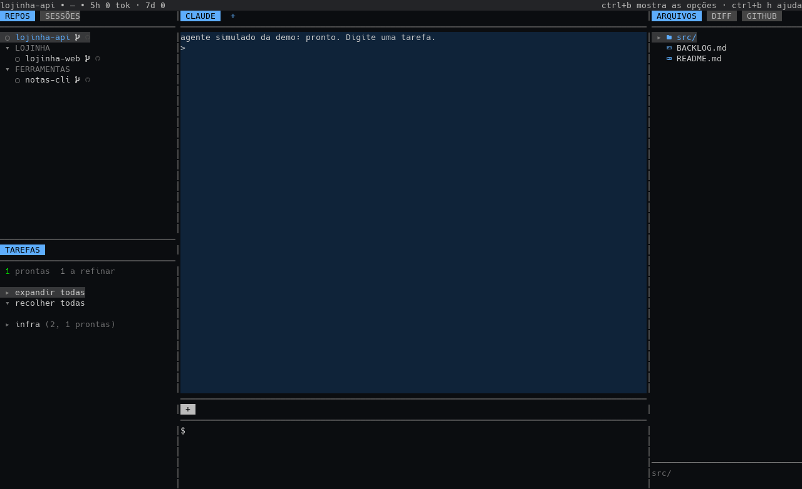

# ai-tmux-workspace

> **Sem garantia (no warranty).** Este software é fornecido "como está", sem garantia de qualquer tipo, expressa ou implícita — incluindo comercialização, adequação a um propósito específico e não violação. Os autores não respondem por qualquer dano, perda de dados ou prejuízo decorrente do uso ou da impossibilidade de usar este software. A licença completa está em [`LICENSE`](LICENSE).
>
> O workspace executa um agente de IA com acesso ao seu sistema de arquivos, terminal e credenciais. Use por sua conta e risco: revise as permissões, mantenha backups e leia o código antes de confiar.



Workspace minimalista baseado em tmux, sem pretensão de ser algo novo: só uma abordagem específica (um repo por janela, agente Claude Code ao lado).

## Instalação

Formato padrão, de uma linha, sem clonar o repo na mão:

```sh
curl -fsSL https://raw.githubusercontent.com/autonomia-tecnologica/ai-tmux-workspace/main/install.sh | sh
```

O script baixa o código para `~/.local/share/ai-tmux-workspace/app`, cria o comando `workspace` em `~/.local/bin` e roda o assistente: dependências, autocomplete, `config.yaml` inicial, harness e hooks do Claude Code. Ele não usa `sudo`/`pkexec`; quando falta um pacote, só mostra o comando para você rodar.

Desfazer: `bash ~/.local/share/ai-tmux-workspace/app/remove.sh` (restaura o que o instalador mudou, apaga o clone em `app/` e o link; só remove a pasta se for um clone git deste repo, nunca um checkout de dev ou symlink). Atualizar a instalação: `workspace update` (git pull --ff-only; clone com alterações locais aborta). Quem desenvolve roda `./install.sh` do próprio clone (modo dev): é o mesmo assistente, sem baixar nada, e `workspace update` recusa esse checkout, que você atualiza com `git pull`.

A filosofia do ambiente de trabalho mora em `ambiente-de-trabalho` (`docs/pt_BR/filosofia.md`) e vale sobre este repo. O manifesto da Autonomia Tecnológica mora primariamente no site (`site/i18n/pt_BR.json`).

**Configuração:** um único `~/.config/ai-tmux-workspace/config.yaml` (`manage`, `profiles`, `main`, `groups` e `prompts`; modelo em `config/config.example.yaml`). O repo guarda só a estrutura. Outro caminho: `AT_WS_CONFIG`. Quem ainda tem o `settings.json` antigo pode migrar pela tela de opções (`ctrl+b o`).

tmux para os repos de `groups` do config.yaml. Comando: `workspace`. Na janela de um repo, o painel principal abre as abas de sessão persistidas; sem nenhuma aba persistida, abre uma sessão do perfil padrão (`agent` no config.yaml) e o `+` da tira de sessões abre o menu de perfis aprovados, com o padrão primeiro (comandos em `profiles`,
ex.: `claude`, ou o mapa com `command` e `settings` descrito em "Settings gerada do agente"). Mudar o perfil padrão pelo menu de opções (Ctrl+b o) não reinicia o
workspace: só vale para sessões novas. `claude` e `opencode-*` podem ser abertos na mesma janela, cada um na sua aba; cada aba pertence a um perfil e a tira rotula `PERFIL` ou `PERFIL (n)`. Cada aba guarda o próprio id de sessão e volta nele depois de `reload`, `restart` ou de fechar/abrir o workspace: Claude com `--session-id` na primeira abertura e `--resume` ao restaurar, OpenCode com `--session` (o id real é gravado pelo plugin). No OpenCode, a aba nova continua a última sessão do repo (`--continue`) e um id inválido tenta `--continue` antes de cair para uma sessão nova. O
servidor tmux (socket `ws-claude`) é separado do seu tmux normal.

    ┌ status: repo • modelo • consumo (5h / 7d, tokens) ───────────────┐
    │ REPOS       │ SESSÕES (abas)         │ ARQUIVOS DIFF GITHUB ... │
    │ ● grupos    │                        │ GITHUB                    │
    ├─────────────┤                        │ (aba escolhida)           │
    │ TAREFAS     ├────────────────────────┤                           │
    │ (BACKLOG)   │ TERMINAL (abas)        │                           │
    └─ 2 ─────────┴──────── 7 ─────────────┴──────────── 3 ───────────┘

Proporção 2:7:3. A coluna esquerda tem os repos (metade de cima) e as tarefas do `BACKLOG.md` do repo da janela (metade de baixo); branch e commits ficam na aba diff.
O repo principal (`main` no config.yaml) fica fora dos grupos, sempre no topo da lista, em laranja (azul quando é o repo da janela).
Cada repo é uma janela do tmux; clicar/Enter num repo da lista troca para ela.

## Settings gerada do agente

Ao abrir um repo, o workspace gera uma settings por perfil em `~/.cache/workspace/settings/<perfil>.json` e sobe o `claude` com `--settings <arquivo>`. O arquivo tem duas partes: a base do harness forçado (hooks e `permissions.deny` do `harness/settings.json` ou do `forcado.yaml` instalado) e o mapa `settings` do perfil no `config.yaml` (URL, modelos, flags, `permissions.defaultMode`). Os hooks e o `deny` da base sempre valem: o `settings` do perfil não os substitui; use o `settings.json` da pessoa para hooks extras.

`manage: false` no topo do `config.yaml` desliga essa gestão: nada de settings gerada, nenhum hook registrado pelo instalador e o `claude` sobe puro, sem `--settings`, `--permission-mode` nem `ENABLE_TOOL_SEARCH=false` (a retomada por aba continua). Sem a chave, o comportamento histórico vale (`manage: true`).

`harness_managed` (padrão `true`) é um interruptor separado: com `manage: false` e `harness_managed: true`, o instalador instala o `HARNESS.md` em `~/.local/share/ai-tmux-workspace/harness/` e acrescenta um bloco idempotente em `~/.claude/CLAUDE.md` mandando ler e seguir essa cópia — é o `claude` bruto com o harness apontado, sem settings nem hooks (o `remove.sh` restaura o arquivo). Com `harness_managed: false`, nada é copiado para o harness nem escrito em `~/.claude`. `manage: true` implica `harness_managed: true`, sem pergunta.

O instalador pergunta, antes de configurar, se o workspace gerencia as opções, quais provedores incluir — entre exatamente `claude`, `opencode-claude`, `opencode-deepseek`, `opencode-openrouter` e `opencode-free` — e qual perfil marcado é o padrão (sugere o primeiro marcado). Ele grava só os marcados em `profiles`, grava a resposta em `agent` e preserva o resto da config: `groups`, `main`, editores, prompts e perfis que já existiam. Numa config antiga ele migra só os nomes legados conhecidos: `opencode` → `opencode-deepseek`, `openrouter` → `opencode-openrouter` (só a chave; o `config` apontado não se move) e remove o perfil `deepseek` apenas quando ele é o Claude+DeepSeek antigo (`command: claude` com a base URL da DeepSeek). Qualquer outro perfil e chave fica como está; se o `agent` apontava para um nome migrado ou removido, ele passa ao equivalente.

`profiles` é a lista de perfis aprovados: são esses que aparecem no menu `+` da tira de sessões. `agent` é o perfil padrão das novas sessões (usado quando uma sessão é aberta sem escolha, como no prompt de tarefa); mudá-lo não reinicia o workspace, só vale para as sessões abertas depois. Como cada aba guarda o próprio perfil, `claude` e `opencode-*` podem ficar na mesma janela.

`profiles` aceita o formato antigo (linha de comando, ex. `claude`) e o novo:

```yaml
profiles:
  claude: claude
  opencode-claude:
    harness: opencode
    command: opencode
    config: ~/.config/ai-tmux-workspace/opencode-claude.json
    model: anthropic/claude-sonnet-5-5
```

Nenhum perfil do catálogo aponta o Claude para um endpoint externo: os provedores externos sobem pelo OpenCode. Um perfil `command: claude` ainda aceita `settings` (URL, modelos, flags, `apiKeyHelper`) para configuração própria, sempre sem bypass: nada de `permissions.defaultMode: bypassPermissions`; a credencial fica no cofre, via `apiKeyHelper`.

Uma linha de comando que já passa `--settings` continua como está: é o formato antigo, e o arquivo continua sendo seu. Para migrar, leve o conteúdo não secreto para `settings` e troque a chave por `apiKeyHelper`, um comando que imprime a chave na hora de subir. A chave de acesso nunca entra no `config.yaml`, na settings gerada nem no ambiente: a settings só aponta para o cofre, e o Claude Code executa o helper no launch. O arquivo gerado fica com modo 0600 e o workspace recusa gerar se encontrar valor literal em `ANTHROPIC_AUTH_TOKEN`, `*_API_KEY`, `*_ACCESS_TOKEN` ou algo com cara de chave. O slot Opus pode apontar para um modelo mais forte mantendo `ANTHROPIC_MODEL` e `CLAUDE_CODE_SUBAGENT_MODEL` no modelo principal; no Claude Code, `/model opus` escolhe esse slot.

O `settings.json` da pessoa e as settings gerenciadas da empresa continuam valendo: o `--settings` é uma camada a mais, e o workspace não controla a precedência. No teste local, uma chave repetida no `--settings` venceu a do `settings.json` da pessoa; as gerenciadas da empresa ficam acima das duas pela documentação do Claude Code (não exercitamos uma gerenciada aqui). `workspace reload` regenera os arquivos: sessões abertas depois dele usam a settings nova; o Claude Code também observa os settings e reaplica a maioria sem reiniciar (documentação dele; não testamos o hot reload aqui).

Enquanto o harness instalado não existir (item 33), a base vem do `harness/settings.json` versionado neste repo e o hook aponta para o `harness/harness.py` do repo; quando o harness instalado existir, a base é montada do `forcado.yaml` instalado e o hook aponta para o script instalado quando ele existe (senão, para o do repo).

## Compatibilidade com modelos não-Claude

Perfis do harness do Claude que não são o `claude` (por exemplo, um perfil próprio com endpoint compatível com a Anthropic) sobem com o *tool search* do Claude Code desligado (`ENABLE_TOOL_SEARCH=false`). O motivo é de compatibilidade: o Claude Code grava o estado do tool search no transcript como blocos `tool_addition`/`tool_definition`, e os endpoints compatíveis com a Anthropic desses provedores recusam esse variant (422 em `messages[1].content`), o que quebra a retomada da sessão (`--continue`/`--resume`). Desligado por padrão, a sessão nova já nasce compatível e a troca de perfil deixa de produzir esse erro. O perfil `claude` não muda; perfis com `harness: opencode` não recebem essa flag.

Todo perfil do harness do Claude — inclusive um perfil próprio que aponte para um endpoint compatível com a Anthropic — abre em `acceptEdits`, o padrão do Claude Code, e nunca em `bypassPermissions` por padrão; sem o classifier, cada comando de Bash pede confirmação. O último modo escolhido é salvo por repo (enquanto a linha de comando do perfil for a mesma) e reaplicado nas aberturas seguintes daquele repo; a troca de perfil não reaplica o modo do perfil anterior. `auto` só é reaplicado em perfil do harness do Claude. Perfis com `harness: opencode` não recebem nenhuma flag de permissão do Claude.

Cada aba tem o próprio id de sessão; uma aba nova abre com `--session-id` (Claude) ou continua a última sessão do repo com `--continue` (OpenCode), e a restauração usa `--resume`/`--session`. Se o id não existir mais, o Claude cai para uma sessão nova e o OpenCode tenta `--continue` antes de abrir uma. Isso não é uma barreira de segurança.

## OpenCode

Um perfil com `harness: opencode` sobe o OpenCode no lugar do Claude Code:

```yaml
profiles:
  opencode-claude:                         # API da Anthropic pelo OpenCode
    harness: opencode
    command: opencode                      # opcional: é o padrão do harness
    config: ~/.config/ai-tmux-workspace/opencode-claude.json
    model: anthropic/claude-sonnet-5-5
  opencode-deepseek:                       # API do DeepSeek
    harness: opencode
    command: opencode
    config: ~/.config/ai-tmux-workspace/opencode-deepseek.json
    model: deepseek/deepseek-flash
  opencode-openrouter:                     # API do OpenRouter
    harness: opencode
    command: opencode
    config: ~/.config/ai-tmux-workspace/opencode-openrouter.json
    model: openrouter/deepseek/deepseek-v4-flash-0731
  opencode-free:                           # provedor `opencode`, modelos free
    harness: opencode
    command: opencode
    config: ~/.config/ai-tmux-workspace/opencode-free.json
    model: opencode/deepseek-v4.1-flash-free
```

Nesse harness o workspace não passa `--settings`, `--permission-mode` nem `ENABLE_TOOL_SEARCH` e não gera settings; as sessões pertencem ao OpenCode. Uma aba nova continua a última sessão do repo (`--continue`); ao restaurar, usa `--session <id>` e, se o id não existir mais, tenta `--continue` antes de abrir uma sessão nova. O id real é gravado pelo plugin do OpenCode em `$WS_STATE/tabs/session-<aba>`. O `config` do perfil é exportado como `OPENCODE_CONFIG`; o OpenCode mescla esse arquivo com a config global dele (`~/.config/opencode`). Sem `config`, o comando roda como está no perfil.

A credencial do provider fica no próprio OpenCode (`opencode auth login anthropic`, `opencode auth login openrouter` ou `opencode auth login deepseek`; gravado em `~/.local/share/opencode/auth.json`), ou na variável de ambiente que o provider lê (ex.: `DEEPSEEK_API_KEY`). Nenhuma chave entra no `config.yaml`. O perfil declara `model`: `anthropic/claude-sonnet-5-5` (`opencode-claude`), `deepseek/deepseek-flash` (`opencode-deepseek`), `openrouter/deepseek/deepseek-v4-flash-0731` (`opencode-openrouter`) e `opencode/deepseek-v4.1-flash-free` (`opencode-free`); o arquivo de config do OpenCode aponta para o mesmo modelo.

As superfícies que dependem do Claude Code degradam com aviso, sem quebrar: a conferência e «Perguntar ao Claude» recusam com uma mensagem clara, o painel SESSÕES mostra o aviso, e o status bar troca modelo/uso por `opencode · sem métricas do Claude`. Prompts salvos, microfone e os nós `run`/`type` do menu continuam funcionando. O plugin do OpenCode chama a mesma política central do hook: com papel de sessão declarado, a mesma ação recebe a mesma decisão (e `ask` bloqueia, porque o plugin não tem canal de confirmação).

## Platforms (Windows)
Decision: Windows is supported only through WSL2, plus the system toast notification (see Notificações). There is no tmux clone and no custom multiplexer for native Windows.

Why:
- tmux does not run on native Windows, and the whole workspace is built on it.
- The launcher (`bin/workspace`) is a bash script.
- `src/viewer.py` and `src/panel_tabs.py` use the POSIX terminal APIs `termios`, `tty`, `select`, `SIGWINCH` and `SIGUSR1`.
- `src/statusbar.py` uses `fcntl.flock`, which is also POSIX-only.

Linux and macOS are the supported platforms; on Windows, run the workspace inside a WSL2 distribution.

The session box (item 64) is documented friction on Windows/WSL2 and in corporate environments: it is a policy enforced by the hook and the OpenCode plugin, not an OS sandbox, so it depends on the agent honouring those adapters.

## Bolinhas
○ parado · 🟢 agente/subagente trabalhando · 🟡 uma ferramenta rodando há mais de 8 s ·
🔴 esperando você (permissão/pergunta). Vêm dos hooks do Claude Code: rode uma vez
`workspace install-hooks` (faz backup do `~/.claude/settings.json`; reinicie as sessões abertas).

## Notificações
Quando uma sessão do Claude passa a 🔴 (precisa de você), o hook dispara uma notificação do sistema:
título = nome do repo, corpo = trecho curto (pergunta, comando pedido ou fim da última resposta). Só na
transição para vermelho, então um pedido de permissão não notifica duas vezes. Desligue com
`notifications: false` no `config.yaml` (padrão: ligado). Plataformas: Linux (`notify-send`), macOS
(`osascript`), WSL2 no Windows (toast via `powershell`, nada a instalar). Se o comando não existir, ignora.

## Extra usage na barra de status (opt-in, desligado por padrão)
Shows the account's monthly extra usage spend next to the 5h/7d percentages, e.g. `$12.30/$50`
(`$1,234/$5,000` from 100 up; separators follow the system locale; only `$12.30` if there is no monthly limit; omitted if extra usage is off or there is no data).
Enable with `extra_usage: true` in `config.yaml`. When off, nothing is read and no request is made.

When on, at most every 5 minutes `src/extra_usage.py` runs detached and does one GET to
`https://api.anthropic.com/api/oauth/usage` with your Claude Code OAuth access token
(`~/.claude/.credentials.json`, or the macOS keychain item `Claude Code-credentials`). Only the numbers
are cached (`extra_usage.json` next to `limits.json`). Risks: the token is an account key; the endpoint
is unofficial and may change or break without notice. Mitigations: fixed host, GET only, 5s timeout,
no redirects, proxies ignored, TLS verified, token never refreshed, logged, printed or written to disk;
an expired token just fails silently. Amounts come in minor units and are divided by
`10 ** decimal_places` from the response.

## Teclas
- painéis: `j/k`, setas, PgUp/PgDn, `g/G`, mouse; Enter abre; no painel de repos, Enter num grupo recolhe.
- lado direito: a barra do topo troca entre ARQUIVOS (padrão) · DIFF atual (Enter abre o diff) ·
  GITHUB (resumo via `gh`: repo, PR da branch com checks, PRs, issues, CI, release). Clique numa aba, ou foque a barra (`ctrl+b ↑`) e use ←/→ + Enter. Arquivos de código abrem no nvim; mídia e documentos (imagem, vídeo, áudio, PDF, Office...) abrem no programa padrão do sistema, e HTML/HTM/XHTML abrem no navegador padrão.
- `ctrl+b h` abre a ajuda · `ctrl+b o` abre a tela de opções (uma árvore só, já expandida: os prompts salvos em `prompts` no `config.yaml`, que são digitados na sessão ativa sem enviar, e perguntar ao Haiku via `claude -p --model haiku` no repo da janela; a conferência com os irmãos ou com repos selecionados do workspace, numa tela de conversa com o log ao vivo e caixa de mensagem no rodapé (digite e Enter envia, Ctrl+X encerra); `options` no `config.yaml` acrescenta nós `ask`, `run` e `type`) · `ctrl+b r` recarrega a config e a tira de abas sem sair do tmux · `ctrl+b d` desanexa (o workspace continua rodando).
- barra do painel de repos: REPOS · SESSÕES (sessões do Claude Code abertas em todos os repos do workspace, agrupadas por repo; subagentes em execução viram uma linha `↳` dentro da sessão pai; Enter foca o painel da sessão; sessões OpenCode não aparecem aqui).
- painel TAREFAS: `→`/`←` expandem/recolhem o item; Enter pede confirmação e manda a mensagem para a sessão ativa (implementar ou refinar).
- tira de sessões (1 linha no topo do painel principal): a janela abre as abas de sessão persistidas; sem nenhuma, abre uma sessão do perfil padrão e, se ela falhar, mostra o aviso para abrir uma sessão pelo `+`. `+` (ou `ctrl+b t`) abre o menu de perfis aprovados, com o padrão primeiro. A primeira sessão ocupa o painel principal e as seguintes viram abas; cada aba guarda o perfil e o próprio id de sessão, e a tira rotula `PERFIL` / `PERFIL (n)`; clique numa aba (ou `ctrl+b n`/`p`) para trocar. Sair da última sessão abre uma nova aba do perfil padrão; se ela falhar, volta ao aviso. As abas de sessão são restauradas no `reload` e no `restart`; as de terminal não.
- `shift+setas` pulam entre painéis.

## Conferência: irmãos ou repos selecionados
Em `ctrl+b o` → **Conferência**, as folhas **Repos irmãos** e **Repos selecionados** criam a conferência e
abrem a tela de conversa. **Repos irmãos** usa o repo da janela e os irmãos dele: o próprio repo da janela
participa, e aparece primeiro no topo. Irmão é o que o `config.yaml` define: `siblings` declarado numa entrada
de `groups` ou outro repo listado dentro do `parent_folder`; estar no mesmo `groups` não basta. **Repos
selecionados** abre a lista de repos do workspace antes: o repo da janela já vem marcado, Espaço marca ou
desmarca, `a` marca todos, `n` limpa e Enter abre com os marcados (Esc cancela). O log aparece na hora e se
atualiza sozinho quando chegam respostas; o topo mostra o que cada participante está fazendo enquanto trabalha
(analisando, lendo um arquivo, buscando).
Na tela: a caixa **Mensagem:** no rodapé é o campo de texto; digite e Enter envia a mesma mensagem para todos.
Fechar a tela encerra a conferência: Ctrl+X encerra explicitamente e Esc fecha e encerra. Não há persistência: a
próxima conferência começa com o log vazio, e a anterior não volta na tela (o log antigo fica só como arquivo).
Fechar o popup ou a janela também encerra, sem deixar conferência pendente: conferência existe só enquanto a tela
existe. Cada participante é um **Claude isolado** (`claude -p`, um processo por repo, sem sessão salva): a sessão
principal da janela não é usada nem alterada, por isso a conferência não depende de os painéis estarem livres. Cada
um fala **só do próprio repo**, mas pode ler os irmãos — a conferência é uma **validação cruzada entre repos**, e
ler os irmãos é recomendado — e, antes de responder, lê o harness (o `CLAUDE.md`/`.claude/CLAUDE.md` e o que ele
mandar ler). Se a mensagem não for do repo, ou for dirigida a outro participante pelo nome do repo, ele **não
responde**: nem linha no log. O prompt lista os participantes e diz a cada um qual é o seu. A conferência é
análise rápida, não trabalho longo: a resposta vem em um parágrafo curto e o run tem um **orçamento** imposto pelo
hook do workspace (12 arquivos lidos e 20 passos de ferramenta); quando ele acaba, o participante responde com o que já sabe e
diz que uma análise mais profunda precisa de mais tempo. Nesse modo o run não altera código: `Edit` só é aceito no
`BACKLOG.md` do próprio repo, e só quando você pedir na mensagem para salvar algo no backlog; o hook do workspace
confere o caminho e nega qualquer outro arquivo, e `Write`, Bash, subagentes e ferramentas de rede ficam desligados.
O backlog é só o que você mandar virar backlog. As respostas aparecem no log conforme cada Claude termina (o topo
mostra quem ainda está aguardando e o passo atual); a caixa **Mensagem:** cresce conforme o texto e mantém o fim
visível. Não há comando de conferência na CLI: a CLI do `workspace` é para instalação e ações administrativas, nunca
para o uso do tmux. O desenho aprovado para a próxima versão — persistência da conferência, `/clear`,
escopo `README.md`/`BACKLOG.md` e Claude/OpenCode — está no `BACKLOG.md`, item 70.

## Comandos
`workspace [perfil]` · `update` (git pull --ff-only do clone instalado) · `--help` (lista os comandos; não abre o tmux) · `reload [perfil]` (recarrega config e painéis sem sair; é o `ctrl+b r`) · `restart [perfil]` (derruba e sobe de novo; só depois de mudar hooks do Claude ou plugins) · `stop [perfil]` · `install` · `install-hooks` · `doctor` (confere o harness instalado contra o `source.json` e a fonte canônica) · `config` (mostra o caminho e o texto do `config.yaml`) · `config update [--apply]` (compara o `config.yaml` com `config/config.example.yaml`, o harness instalado, as settings por perfil e os hooks do Claude com este repo).

`workspace config update` sem argumento só mostra a diferença. Com `--apply`: acrescenta ao `config.yaml` só o que falta (uma chave ou um item de lista, por texto exato), sem alterar nem remover o que você tem; antes grava um backup `config.yaml.bak-<data>`. O que você já viu ou removeu não volta: fica registrado em `~/.config/ai-tmux-workspace/state/config-offered.json`. Perfis, grupos, caminhos e relações nunca são tocados. O harness instalado, as settings geradas e os hooks são regenerados a partir da fonte e deste repo. `workspace reload` basta; hooks valem nas sessões do Claude que abrirem depois.

## HARNESS.md enxuto

O texto que o agente recebe em toda sessão é o `harness/HARNESS.md` deste repo, com só tópicos
operacionais: ele é enxuto de propósito, para gastar menos token por sessão. A descrição aberta e o
histórico das regras ficam no repositório `ambiente-de-trabalho`; o instalador copia a versão enxuta
por cima da cópia da fonte. O `source.json` continua registrando o sha256 da fonte descritiva e o da
cópia instalada, e o `workspace doctor` compara os dois.

## Persistência
Sem plugins de tmux. As abas de sessão de cada repo ficam em `$WS_STATE/tabs/`: uma lista ordenada com o perfil e o id de cada aba, mais `session-<aba>` com o id real gravado pelo hook do Claude e pelo plugin do OpenCode. `reload`, `restart` e fechar/abrir o workspace restauram as abas na ordem, cada uma no próprio id; sem abas persistidas, abre a padrão. O resto vem do `config.yaml` e dos arquivos do repo.
O estado de runtime fica em `~/.cache/workspace` (`WS_STATE`). Os nomes de contrato interno agora são em inglês
(`WS_STATE`/`WS_PROFILE`, opções `@ws_*`, `@role`, papéis e chaves de estado); o estado antigo é descartável e um
`workspace restart` é necessário depois desta mudança. O desenho aprovado separa
config/estado em `~/.config/ai-tmux-workspace` (`state/`, `conference/`) do código e do
`HARNESS.md` em `~/.local/share/ai-tmux-workspace` (`app/`, `harness/`, `security/`), com escopo por
repo/home/conferência; está no `BACKLOG.md`, item 72. O harness instalado guarda um `source.json`
lateral com a fonte, o commit e os sha256 do `HARNESS.md`; `workspace doctor` compara esse registro
com a cópia instalada e a fonte canônica, e o `reload` mostra o aviso sem abortar.

## Arquivos
`config/config.example.yaml` (modelo da config) · `config/tmux.conf` · `bin/workspace` (launcher) · `src/panel_*.py` (incl. `panel_tabs.py`, a tira de abas, e `panel_tasks.py`) ·
`src/viewer.py` (desenho sem flicker: só reescreve as linhas que mudaram) · `src/hook.py` · `src/statusbar.py` · `src/backlog.py` (parser do `BACKLOG.md`) ·
`src/help.py` (popup da ajuda) · `src/conference.py` (discussão entre o repo da janela e os irmãos) · `src/conference_worker.py` (o Claude isolado que responde por um repo) · `src/opener.py` · `src/extra_usage.py` · `src/notify.py` · `docs/threat-model.md` (modelagem de ameaças) · `docs/threat-model.json` (requisitos; fonte da verdade).

## Segurança: resumo

O Claude executa comandos com as permissões da sua conta; o ai-tmux-workspace organiza tmux, sessões, config e hooks; a regra do ambiente mora em `ambiente-de-trabalho`.

- **Forçado x recomendado:** o hook (código) é o freio que conta; o `HARNESS.md` é texto que a LLM pode ignorar. Mesmo o hook tem lacunas abertas.
- **Sem isolamento de sistema operacional hoje:** o agente roda com a sua conta. Usuário dedicado e arquivos de outro dono são objetivo do item 35 (pausado), não garantia atual.
- **Não instale pedindo a uma LLM:** o `install.sh` pede confirmação a cada passo; quem responde é você.
- **Desfazer:** `remove.sh` restaura o que o instalador mudou, pelo manifesto de backup.
- **Sem privilégio:** o workspace não roda como root nem sob `sudo`/`pkexec`.
- **Falha aberta:** a LLM pode alterar a lista de repos do `config.yaml`.
- **Seu `settings.json`:** o workspace só acrescenta hooks e statusLine, com backup; hooks de terceiros não são tocados.

Detalhes, o que é garantia e o que é só atrito: [`SECURITY.md`](SECURITY.md).

## Segurança: modelagem de ameaças

A modelagem está em `docs/threat-model.md` (leitura humana) e `docs/threat-model.json` (fonte da verdade, processável): OWASP Top 10 for LLM Applications 2025 + OWASP Top 10 for Agentic Applications + MITRE ATLAS v2026.10. Cada requisito tem um status (`out_of_scope`, `needs_decision`, `implemented` ou `not_implemented`), evidência, onde falha e como validar.

O código do próprio workspace (o clone de dev ou a cópia instalada, em `WS_DIR`) é caminho protegido pela política central, com fallback para o diretório de onde o hook roda. Qualquer papel pode lê-lo; escrevê-lo só a sessão de dev, cujo `WS_SESSION_ROOT` está dentro dessa raiz. A home também é negada, e o caminho não entra na config nem em `siblings`.

### Caixa da sessão

A caixa da primeira versão é a política do harness, não um sandbox de SO. Ao abrir um repo, o launcher prefixa a linha do agente com `WS_SESSION_ROLE`/`WS_SESSION_ROOT` (`src/session.py`): o repo principal do `config.yaml` abre como `home` e pode alterar os outros repos; qualquer outro caminho abre como `repo` e escreve só no próprio repo e em `/tmp`. Configuração da máquina (`~/.config`, `~/.claude`, a cópia instalada) é somente leitura para a sessão de repo. A raiz declarada vence os roots de configuração, então um worktree em `~/.local/share/ai-tmux-workspace/worktrees/...` escreve no próprio worktree; segredo continua negado dentro da caixa. `auto` não é fixado no launch: a política lê o modo do evento (`permission_mode`) e só dispensa o prompt dentro da caixa; `deny` vale em todo modo. Com papel declarado, falha do motor vira `deny` no hook, igual ao plugin do OpenCode. A conferência não recebe papel: ela continua com o orçamento próprio de escrita.

**Isto não é uma garantia.** O estado atual tem lacunas conhecidas, entre elas: a caixa é política de harness, não usuário de SO nem sandbox (item 74); a home escreve em qualquer repo do ambiente por decisão (o recomendado é trabalhar por pasta), e o código do workspace é a exceção protegida; a conferência atual não é persistente e lê mais arquivos do que o desenho aprovado; e a persistência está dividida entre `~/.cache/workspace` e `~/.local/share`. O README mostra o código como ele está hoje; o que se espera dele está no `BACKLOG.md` (itens 70–72) e a lista completa de requisitos está no JSON.

Falha aberta conhecida: hoje a própria LLM gerencia quais repositórios entram na config (lista de repos em `config.yaml`). Isso significa que ela poderia adicionar qualquer pasta do ambiente ao workspace. A lista de repos não é uma barreira contra a LLM.

### Controle de comandos

O controle de comandos está em aberto e precisa ser pensado junto com o controle de arquivos e pastas, não isolado dele. A resolução é a pessoa — o agente pede e a pessoa aprova — e não bloquear tudo completamente, que trava trabalho legítimo no repo. Enquanto o desenho não fecha, o modo decisão é interino e opt-in: com o marcador `~/.cache/workspace/policy.ask` (ou `WS_POLICY_ASK=1`) o comando ou a ferramenta que o motor não classifica vira `ask` em vez de `deny`, e `net`/`install` que a tabela manda negar também passam a `ask`; cada decisão vai para o `policy.jsonl` com o motivo `policy.reason.ask_mode`. Segredos, comandos administrativos, leitura fora da caixa, escrita na config e escrita no código do workspace continuam negados: o controle de arquivos e pastas não é afrouxado. O marcador é da pessoa; apagá-lo fecha o modo de novo.

**Isto é uma medida interina, não o desenho final do controle de comandos.**

## Textos (i18n)
Todo texto exibido e todo prompt enviado ao agente ativo mora em `i18n/` (hoje só `pt-BR`): `i18n/pt-BR.json` (chaves lidas por `src/i18n.py`) e `i18n/HELP.pt-BR.md` (a ajuda do `ctrl+b h`). Idioma novo = arquivos novos nessa pasta.
